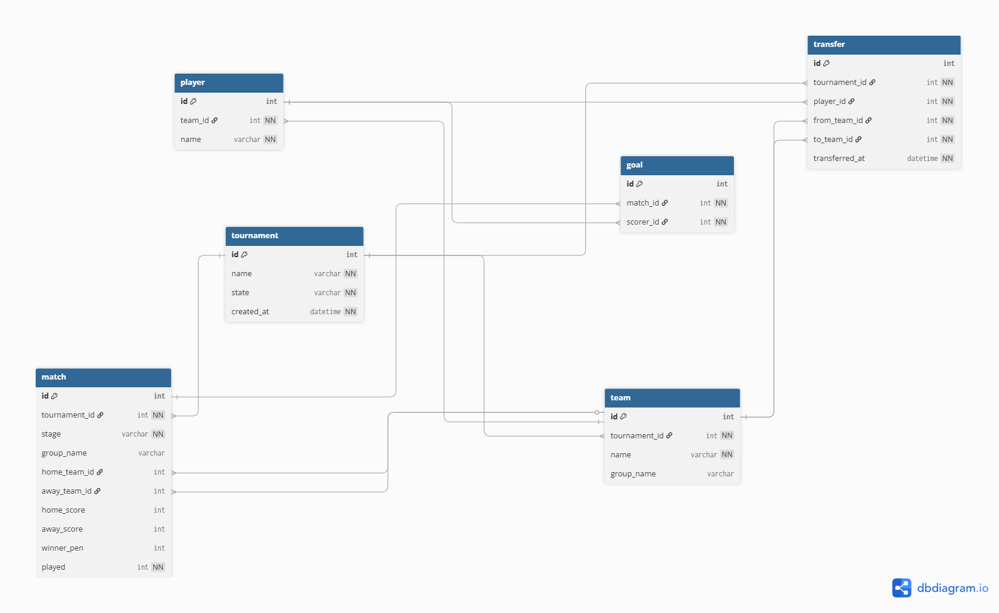

# Tournament Management App

Aplikacja desktopowa do prowadzenia turnieju piłkarskiego dla **12 drużyn**: od
rejestracji drużyn i zawodników, przez losowanie grup i fazę grupową
(system każdy z każdym), aż po trzy równoległe drabinki pucharowe wyłaniające
końcową klasyfikację miejsc 1–12. Aplikacja obsługuje także transfery
zawodników, rejestrację strzelców bramek oraz raporty agregujące (tabele grup,
klasyfikacja strzelców, statystyki drużyn, historia transferów).

Dokumentacja koncentruje się na warstwie technicznej — przede wszystkim na
modelu danych i sposobie realizacji operacji w bazie danych.

---

## 1. Wykorzystywane technologie

| Warstwa | Technologia 
|---|---|
| Język | **Python 3.10+** |
| Baza danych | **SQLite 3**  |
| GUI | **PySide6** |
| Testy | **unittest** (biblioteka standardowa) | 

---

## 2. Model / schemat bazy danych



Baza składa się z **6 tabel**, **4 widoków** i **7 triggerów**. Poniżej opis encji.

### 2.1. Tabela `tournament`

*Opis: Turniej i jego stan w postaci automatu skończonego `SETUP → GROUP → KO → FINISHED`. Stan steruje tym, jakie operacje są dozwolone (np. losowanie tylko w `SETUP`, transfery tylko przed `KO`).*

| Kolumna | Typ | Opis |
|---|---|---|
| id | INTEGER | Identyfikator turnieju (PK) |
| name | TEXT | Nazwa turnieju (NOT NULL) |
| state | TEXT | Stan turnieju: `SETUP`/`GROUP`/`KO`/`FINISHED` (NOT NULL, DEFAULT `SETUP`, CHECK) |
| created_at | DATETIME | Data utworzenia (NOT NULL, DEFAULT `CURRENT_TIMESTAMP`) |

### 2.2. Tabela `team`

*Opis: Drużyna należąca do turnieju. Para `(tournament_id, name)` jest unikalna.*

| Kolumna | Typ | Opis |
|---|---|---|
| id | INTEGER | Identyfikator drużyny (PK) |
| tournament_id | INTEGER | Turniej drużyny (NOT NULL, FK → tournament.id, ON DELETE CASCADE) |
| name | TEXT | Nazwa drużyny (NOT NULL) |
| group_name | TEXT | Grupa `A`/`B`; `NULL` do czasu losowania (CHECK) |

### 2.3. Tabela `player`

*Opis: Zawodnik przypisany do drużyny. Zmiana `team_id` oznacza transfer (obsługiwany triggerami).*

| Kolumna | Typ | Opis |
|---|---|---|
| id | INTEGER | Identyfikator zawodnika (PK) |
| team_id | INTEGER | Drużyna zawodnika (NOT NULL, FK → team.id, ON DELETE CASCADE) |
| name | TEXT | Imię i nazwisko zawodnika (NOT NULL) |

### 2.4. Tabela `match`

*Opis: Pojedynczy mecz. Pole `stage` rozróżnia fazę grupową od 9 etapów pucharowych w trzech drabinkach (TOP/MID/BOT: półfinał, finał, mecz o miejsce).*

| Kolumna | Typ | Opis |
|---|---|---|
| id | INTEGER | Identyfikator meczu (PK) |
| tournament_id | INTEGER | Turniej meczu (NOT NULL, FK → tournament.id, ON DELETE CASCADE) |
| stage | TEXT | Etap: `GROUP` lub etap KO, np. `SF_TOP`/`FINAL_TOP`/`THIRD_PLACE` (NOT NULL, CHECK) |
| group_name | TEXT | Grupa `A`/`B` dla meczu grupowego; `NULL` dla KO (CHECK) |
| round | INTEGER | Numer kolejki fazy grupowej; `NULL` dla meczów KO |
| home_team_id | INTEGER | Gospodarz (FK → team.id, ON DELETE SET NULL) |
| away_team_id | INTEGER | Gość (FK → team.id, ON DELETE SET NULL) |
| home_score | INTEGER | Bramki gospodarza (CHECK ≥ 0) |
| away_score | INTEGER | Bramki gościa (CHECK ≥ 0) |
| winner_pen | INTEGER | Rozstrzygnięcie po karnych: 0 = gospodarz, 1 = gość, `NULL` = bez karnych (CHECK) |
| played | INTEGER | Czy rozegrany: 0/1 (NOT NULL, DEFAULT 0, CHECK) |

### 2.5. Tabela `goal`

*Opis: Pojedyncza bramka — powiązanie meczu ze strzelcem. Liczba rekordów meczu musi zgadzać się z sumą wyniku (walidowane w warstwie serwisu).*

| Kolumna | Typ | Opis |
|---|---|---|
| id | INTEGER | Identyfikator bramki (PK) |
| match_id | INTEGER | Mecz, w którym padła (NOT NULL, FK → match.id, ON DELETE CASCADE) |
| scorer_id | INTEGER | Strzelec (NOT NULL, FK → player.id, ON DELETE CASCADE) |

### 2.6. Tabela `transfer`

*Opis: Dziennik audytu transferów. Nie jest wypełniany ręcznie — wiersze wstawia automatycznie trigger po zmianie `team_id` zawodnika.*

| Kolumna | Typ | Opis |
|---|---|---|
| id | INTEGER | Identyfikator transferu (PK) |
| tournament_id | INTEGER | Turniej transferu (NOT NULL, FK → tournament.id, ON DELETE CASCADE) |
| player_id | INTEGER | Przeniesiony zawodnik (NOT NULL, FK → player.id, ON DELETE CASCADE) |
| from_team_id | INTEGER | Drużyna źródłowa (NOT NULL, FK → team.id, ON DELETE CASCADE) |
| to_team_id | INTEGER | Drużyna docelowa (NOT NULL, FK → team.id, ON DELETE CASCADE) |
| transferred_at | DATETIME | Data transferu (NOT NULL, DEFAULT `CURRENT_TIMESTAMP`) |

### Reguły integralności wymuszane w bazie

Model celowo przenosi **reguły biznesowe do schematu**, aby były nienaruszalne
niezależnie od tego, która część kodu modyfikuje dane:

- **Więzy `CHECK`** — spójność pojedynczego wiersza, np.:
  - mecz grupowy musi mieć grupę, mecz KO nie może jej mieć;
  - mecz „rozegrany” (`played=1`) musi mieć oba wyniki, „nierozegrany” — żadnego;
  - karne (`winner_pen`) dozwolone tylko dla remisu w fazie pucharowej;
  - drużyna nie może grać sama ze sobą; wyniki nieujemne.
- **Klucze obce z `ON DELETE`** — kaskady (`CASCADE`) i odpięcia (`SET NULL`)
  utrzymują spójność referencyjną przy usuwaniu turnieju/drużyny.
- **`UNIQUE (tournament_id, name)`** — brak zdublowanych nazw drużyn w turnieju.

### Triggery (logika w bazie)

| Trigger | Moment | Reguła |
|---|---|---|
| `trg_player_squad_limit` | BEFORE INSERT player | Limit składu: maks. 10 zawodników w drużynie. |
| `trg_transfer_audit` | AFTER UPDATE player.team_id | Automatyczny wpis do dziennika `transfer`. |
| `trg_transfer_window` | BEFORE UPDATE player.team_id | Blokada transferów po starcie fazy KO. |
| `trg_transfer_min_squad` | BEFORE UPDATE player.team_id | Drużyna źródłowa nie może spaść poniżej 5 zawodników. |
| `trg_goal_scorer_valid` | BEFORE INSERT goal | Strzelec musi grać w jednej z drużyn meczu. |
| `trg_match_teams_same_tournament_*` | BEFORE INSERT/UPDATE match | Obie drużyny meczu muszą należeć do tego samego turnieju. |

### Widoki (warstwa odczytu)

| Widok | Zawartość |
|---|---|
| `v_group_table` | Tabela grupy: rozegrane, W/R/P, bramki strzelone/stracone, bilans, punkty. |
| `v_scorers` | Klasyfikacja strzelców per turniej (liczba bramek na zawodnika). |
| `v_match_schedule` | Terminarz z nazwami drużyn zamiast surowych ID. |
| `v_transfer_history` | Historia transferów z nazwami zawodnika i drużyn. |

---

## 3. Realizacja operacji w bazie danych


### 3.1. Połączenie i konfiguracja (`db/init.py`)

Każde połączenie konfiguruje dwa istotne PRAGMA:

```python
conn.execute("PRAGMA foreign_keys = ON")    # SQLite domyślnie nie egzekwuje kluczy obcych
conn.execute("PRAGMA journal_mode = WAL")    # Write-Ahead Logging
```

- **`foreign_keys = ON`** — SQLite dla zgodności wstecznej domyślnie nie wymusza
  kluczy obcych; włączamy egzekwowanie jawnie przy każdym połączeniu.
- **`journal_mode = WAL`** — tryb Write-Ahead Logging pozwala czytać bazę w
  trakcie zapisu (czytelnicy nie blokują pisarza i odwrotnie), co poprawia
  współbieżność GUI ↔ operacje zapisu.

Ustawiono też `row_factory = sqlite3.Row`, dzięki czemu wiersze są dostępne
jak słowniki (`row["points"]`) — czytelniej niż indeksy pozycyjne.

### 3.2. Bezpieczeństwo zapytań 

Wszystkie zapytania używają parametrów `?` zamiast sklejania stringów —
**ochrona przed SQL injection** i poprawna obsługa typów:

```python
conn.execute("INSERT INTO team (tournament_id, name) VALUES (?, ?)",
             (tournament_id, name))
```

### 3.3. Transakcje atomowe (`app/services/`)

Operacje wieloetapowe są opakowane w jawne transakcje `BEGIN IMMEDIATE … COMMIT`
z `rollback()` na wyjątku. Wzorzec:

```python
conn = get_connection()
try:
    conn.execute("BEGIN IMMEDIATE")
    ...                  # wiele instrukcji
    conn.commit()
except Exception:
    conn.rollback()      # albo wszystko, albo nic
    raise
finally:
    conn.close()
```

Przykłady operacji atomowych:
- **Losowanie grup** (`draw.py`) — wyczyszczenie grup, przydział 6+6 drużyn i
  zmiana stanu turnieju to jedna transakcja.
- **Generowanie terminarza** (`schedule.py`) — wszystkie mecze round-robin obu
  grup wstawiane w jednej transakcji.
- **Zapis wyniku meczu** (`match_result.py`) — przypadek złożony: zapis
  wyniku oraz wszystkich strzelców, a jeśli to **ostatni** mecz fazy grupowej —
  **w tej samej transakcji** następuje rozstawienie trzech drabinek KO
  (`seed_brackets`). Operacja jest atomowa — zapis następuje w całości albo wcale.

### 3.4. Kontrola współbieżności 

Transfer zawodnika to **zasób limitowany**:
do drużyny z jednym wolnym miejscem (limit składu = 10) dwóch użytkowników
może próbować przenieść zawodnika jednocześnie. Dokładnie jeden może wygrać.

Zastosowano dwie nakładające się techniki (`transfer.py`):

1. **`BEGIN IMMEDIATE`** — od razu bierze blokadę zapisu na bazie, więc druga
   transakcja czeka (lub dostaje `database is locked`).
2. **Warunkowy UPDATE (compare-and-set)** — kluczowy mechanizm:

```python
rows_updated = conn.execute(
    "UPDATE player SET team_id = ? WHERE id = ? AND team_id = ?",
    (to_team_id, player_id, from_team_id)
).rowcount

if rows_updated == 0:
    raise ValueError("Zawodnik został właśnie przeniesiony — spróbuj ponownie.")
```

Warunek `AND team_id = from_team_id` sprawia, że jeśli inna transakcja zdążyła
przenieść zawodnika, `UPDATE` dotknie **0 wierszy** i operacja jest odrzucana —
decyzja podejmowana jest na podstawie aktualnego stanu rekordu.

3. **Mechanizm retry** (`with_retry`) — przy `sqlite3.OperationalError:
   database is locked` operacja jest ponawiana z rosnącym opóźnieniem
   (backoff), co pozwala obsłużyć przejściowe kolizje blokad WAL.

Poprawność potwierdza test `test_two_users_compete_for_last_squad_slot`


### 3.5. Logika w bazie zamiast w aplikacji

Przeniesiono część reguł do bazy (triggery + widoki), zamiast
implementować je w Pythonie:

- **Audyt transferów** realizuje trigger `trg_transfer_audit` — warstwa serwisu
  wykonuje sam `UPDATE player`, a wpis historii powstaje automatycznie. Dzięki
  temu **każda** zmiana drużyny zawodnika jest zarejestrowana, niezależnie od
  ścieżki kodu.
- **Walidacje** (limit/minimum składu, okno transferowe, poprawność strzelca)
  są w triggerach — stanowią ostateczną linię obrony nawet gdyby walidacja
  aplikacyjna została pominięta. Warstwa serwisu sprawdza je też wcześniej, by
  zwrócić czytelny komunikat błędu.

### 3.6. Raporty agregujące (`app/reports/`)

Raporty to złożone zapytania **z całą logiką po stronie SQL** — Python tylko
mapuje wynik na listę słowników. Wykorzystane konstrukcje:

- **`JOIN`** wielu tabel (np. `goal` → `match` → `player` → `team`).
- **`GROUP BY` + funkcje agregujące** (`COUNT`, `SUM`, `AVG`, `ROUND`).
- **Wyrażenia warunkowe** `CASE WHEN` do liczenia punktów i bilansu.
- **CTE (`WITH …`)** — np. `team_stats` buduje pomocniczy zbiór „gier” drużyny
  (raz jako gospodarz, raz jako gość), a następnie agreguje statystyki.
- **Widoki** jako gotowe, reużywalne źródła (`v_group_table`, `v_scorers` …),
  z sortowaniem wg regulaminu: punkty → różnica bramek → bramki strzelone.

### 3.7. Algorytmika wspierana bazą

- **Algorytm Bergera** (`schedule.py`) generuje kolejki systemu „każdy z każdym”
  dla 6 drużyn (rotacja stolika), a wynik trafia do tabeli `match`.
- **Propagacja drabinki KO** (`bracket.py`) — po wpisaniu wyniku półfinału
  zwycięzca trafia do finału, a przegrany do meczu o miejsce; klasyfikacja po
  grupie pobierana jest z widoku `v_group_table`.

---

## 4. Uruchomienie projektu

### Wymagania
- Python **3.10 lub nowszy**
- System: Windows / Linux / macOS

### Instalacja i start

```bash
# 1. (zalecane) wirtualne środowisko
python -m venv .venv
# Windows:
.venv\Scripts\activate
# Linux/macOS:
source .venv/bin/activate

# 2. instalacja zależności (GUI)
pip install -r requirements.txt

# 3. uruchomienie aplikacji
python main.py
```

Przy pierwszym uruchomieniu `main.py` automatycznie tworzy bazę
`db/tournament.db` ze schematu `db/schema.sql` (jeśli plik jeszcze nie istnieje).

### Ręczna inicjalizacja bazy (opcjonalnie)

```bash
python -m db.init
```

### Uruchomienie testów

```bash
python -m unittest discover -s tests
```